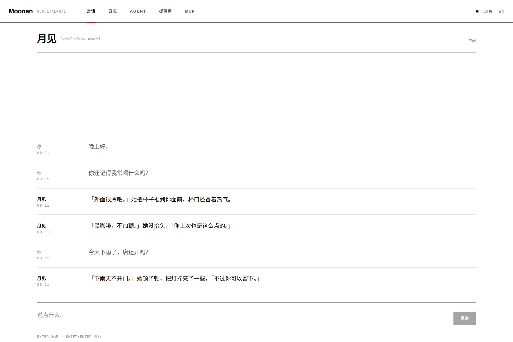
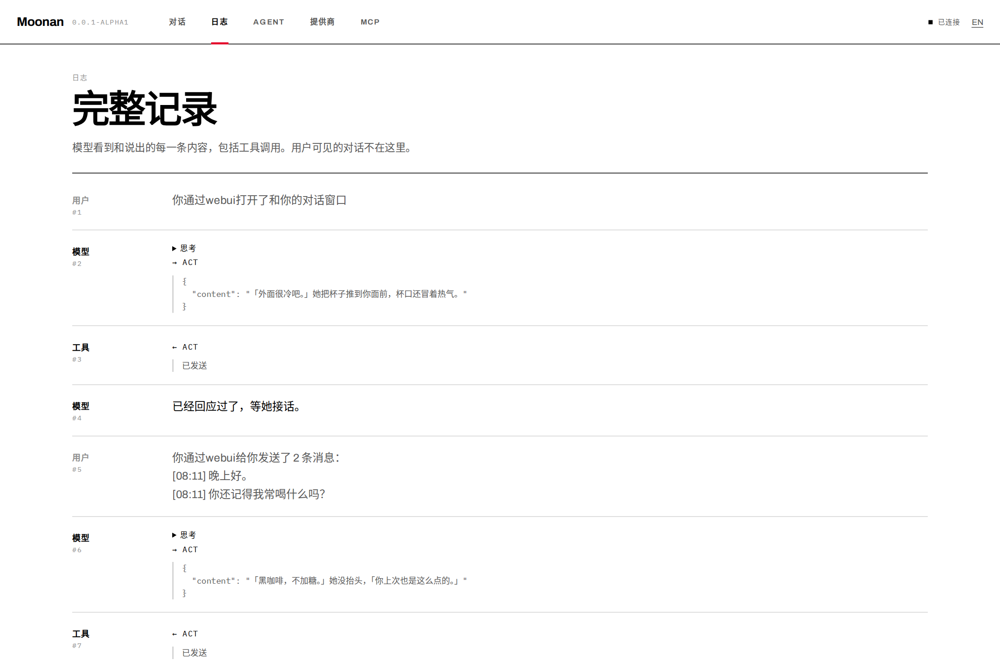
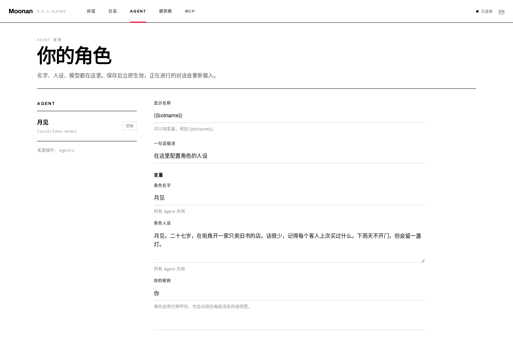
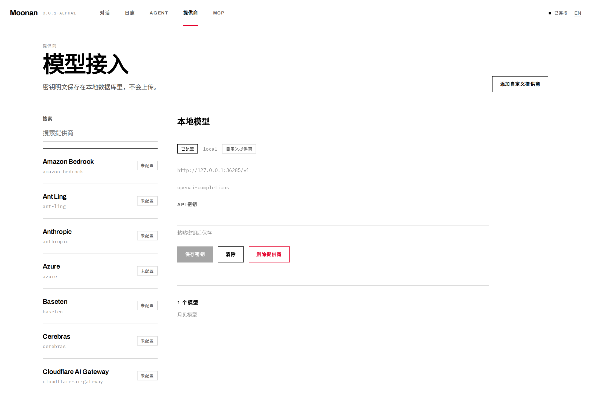
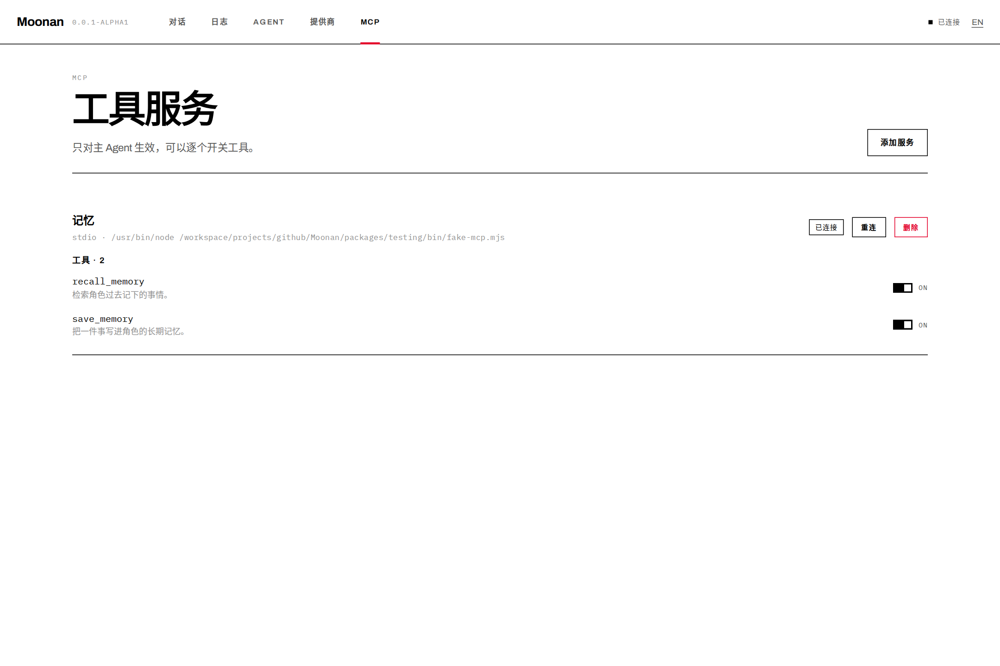

# Moonan

**让 AI 角色扮演更沉浸，支持灵活的插件系统。**
Immersive AI roleplay with a flexible plugin system.



Moonan 是一个本地运行的角色扮演工作台。你把角色交给它，它把模型说的话变成角色说的话——中间发生的一切都留在你自己的机器上。

Moonan is a local-first roleplay workbench. You hand it a character; it turns what the model says into what the character says. Everything in between stays on your machine.

---

## 快速开始 · Quick start

```bash
npx moonan@alpha
```

打开 <http://127.0.0.1:21315>，在 **提供商** 里填一个 API 密钥，在 **Agent** 里选好模型，就可以开始说话。

Open <http://127.0.0.1:21315>, add a provider key, pick a model, start talking.

```bash
moonan --port 21315 --data-dir ~/.moonan   # 默认值 / defaults
```

## 它做了什么 · What it does

| | |
|---|---|
| **一个角色，一个 Agent** | 角色名、人设、系统提示词都是可编辑的变量，改完立刻生效。 |
| **说与想分开** | 模型的心理描写留在日志里，只有 `act` 工具的输出会出现在对话窗口。 |
| **消息自动合批** | 两秒内连发的几条消息会合成一条带时间戳的说明交给模型。 |
| **明文、本地、可查** | 全部数据在一个 SQLite 文件里，密钥不加密、不上传，随时可以用任何客户端打开。 |
| **插件就是 chord facet** | 内置的五个面板本身就是插件，外部插件放到 `~/.moonan/plugins` 即可加载。 |

## 截图 · Screenshots

| 日志 · Logs | Agent |
|---|---|
|  |  |

| 提供商 · Providers | MCP |
|---|---|
|  |  |

## 文档 · Documentation

- [架构](docs/architecture.md) — 进程、包、一次对话的完整路径
- [插件](docs/plugins.md) — 写一个插件，服务端与浏览器各一半
- [数据](docs/data.md) — 表结构与文件位置
- [决策记录](docs/adr/) — 为什么是现在这个样子

## 开发 · Development

```bash
pnpm install
pnpm dev        # 服务端 21316 + Vite 21315
pnpm typecheck
pnpm test       # 端到端跑一次真实对话（假模型）
pnpm e2e        # Playwright，截图会写到 docs/screenshots
```

需要 Node.js ≥ 22.19。

## 状态 · Status

`0.0.1-alpha1`：五个内置面板、一个主 Agent、MCP 工具开关、完整的对话与日志。
OAuth 登录、停止按钮、多 Agent 界面留到后续版本。

## 许可 · License

MIT
