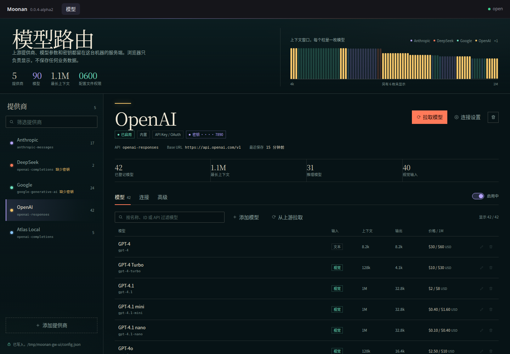
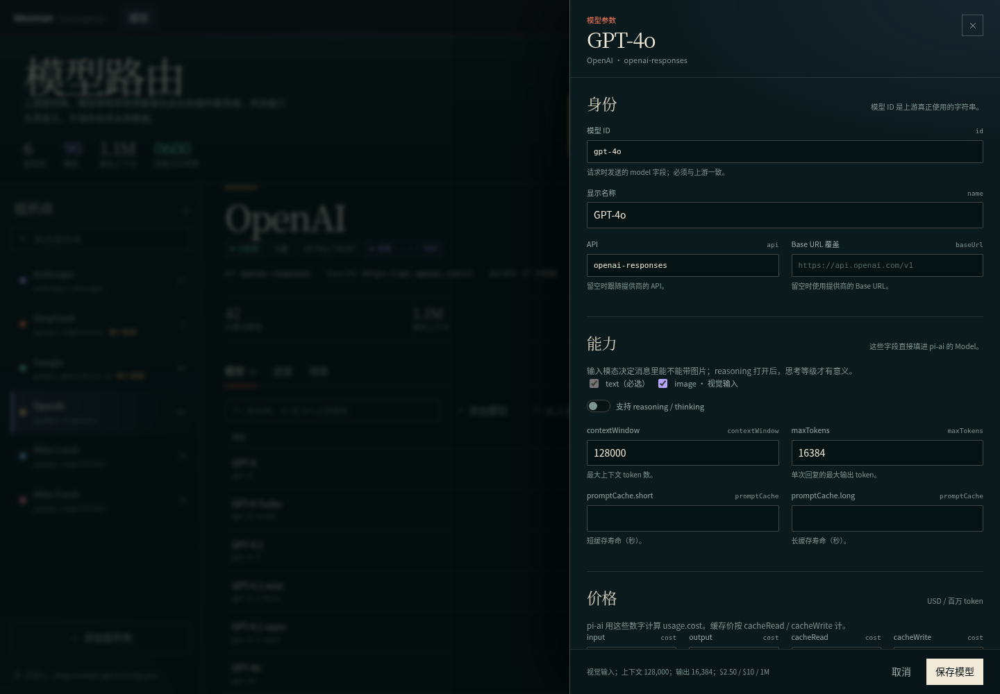
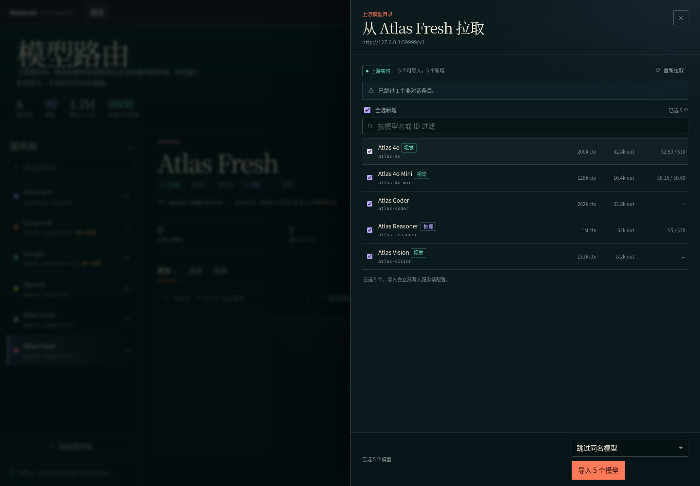
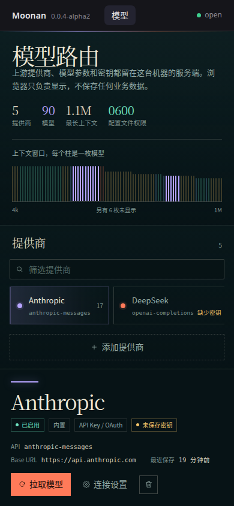

# ai-gateway

Moonan 的内置「模型」插件。它把 pi-ai 的提供商和模型配置搬进一个登录后的面板，并把所有业务数据
写在服务端——浏览器只拿快照，不写任何浏览器存储。配置**按账户隔离**：每个登录用户只看到、只导出自己的
提供商、密钥、模型与请求默认值。

```bash
# 平台已经通过 optionalDependencies 带上这个插件：直接启动即可
npm i -g @moonan_ai/moonan
moonan

# 或者从仓库根目录
pnpm install
pnpm dev          # 模型 + 插件两个面板
pnpm start        # 同上去掉 chord 的写入校验
```

第一次启动先在浏览器里创建管理员并登录，之后打开 <http://127.0.0.1:21315/#/ai-gateway>，通过「添加提供商」
接入第一路上游。没有登录时面板不会加载。

## 界面







小屏时提供商变成横向频道条，表单与抽屉占满宽度。



## 数据放在哪

配置是平台统一数据存储里的 `ai-gateway/config` 数据集，**每个账户一行**（owner 是 `user:<账户 uuid>`），
默认数据库 `~/.moonan/data.db`。数据库由 `node:sqlite` 内嵌在进程里，没有单独的数据库服务：

- 平台目录 `0700`，数据库文件 `0600`；WAL 日志模式、`synchronous=NORMAL`；
- 每次保存都在一个事务里完成，失败会整体回滚，revision 只在提交后前进；
- 表结构迁移记录在 `moonan_data_schema`，数据集行在 `moonan_data_datasets`（`(owner, namespace)` 主键、
  JSON `value`、`updated_at`），全局 revision 与数据集总数在 `moonan_data_meta`；
- 数据库文件不是 SQLite 或磁盘镜像损坏时，会被隔离为 `data.corrupt-<timestamp>.db`，然后以空库重新开始，
  面板会显示提示；不再有 `.bak` 或 JSON 文件恢复路径；
- API Key 以明文保存在插件数据数据库里（面板不假装它是密钥链），快照和 HTTP 响应只含 `hasKey` 与末四位提示；
- `headers`/`env`、以及模型级 `headers` 中名称像凭据的项（`Authorization`、`api-key`、`token`、`secret` 等）
  与 API Key 同等级：快照、HTTP 响应和默认导出里显示为 `moonan:redacted`，服务端数据库里仍是明文；面板保存时
  未改动这些值会保留原值；
- `/api/data/export` 仍是可移植的 JSON 包（`moonan.data` v1），**只导出当前登录账户的配置**，默认脱敏，
  `?includeSecrets=1` 才导出明文；导入在一个事务里原子完成，脱敏包按 provider id / model id 保留已有密钥与
  敏感值。跨机器导入脱敏包时，这些敏感值没有可回填的当前值，会被丢弃（与 API Key 相同语义）。管理员也不能
  导出别人的账户数据。

决定加载哪些插件的 `~/.moonan/plugins.json` 仍是 JSON 引擎配置，故意留在数据存储之外：它在 Chord host 存在
之前就要读取，导入数据也不应改变插件加载集合。账户与会话则在另一个数据库 `~/.moonan/auth.db`（`--auth-db`），
同样不属于插件导出。

路径可用 `--data-db` / `--auth-db` 或环境变量覆盖：

```bash
node packages/platform/bin/moonan.js --plugin @moonan_ai/ai-gateway --data-db /path/to/data.db --auth-db /path/to/auth.db
MOONAN_DATA_DB=/path/to/data.db MOONAN_AUTH_DB=/path/to/auth.db \
  node packages/platform/bin/moonan.js --plugin @moonan_ai/ai-gateway
```

这是多用户重构的破坏性变更：旧的全局 `ai-gateway/config`（schema 1、没有 owner）在数据库升级到 schema 2 时被
丢弃；旧的 `~/.moonan/ai-gateway/config.json` 也不再读取。升级后需要每个账户重新录入配置（本项目尚无需要
保留的数据，因此不提供迁移路径）。

## 按账户隔离

- 服务端契约 `AiGateway` 升到 **v4**，是**按主体**（per principal）的远程对象：每个登录会话拿到自己的实例，
  `snapshot` 是该账户配置的投影；换账户或重新登录就是另一组对象。
- 服务端切面用一个宿主级（host-lifetime）对象注册全局贡献：`DataCodecs`（`ai-gateway/config` codec）、
  `Routes`（下面那组 HTTP 接口）与 `ModelProviders`。它是本地契约 `GatewayAdmin`（`moonan.ai-gateway.admin` v1，
  没有成员），只负责“注册一次”，不持有任何账户配置。注册表是全局的，但每次读写都按请求主体的 owner 取数据。
- 服务端切面重载不会丢配置：`DataStore` 是权威，`config` cell 是投影；导入或「高级」页的重新加载会重读
  **当前账户**的数据集。账户 A 的保存不会出现在账户 B 的面板里。
- 浏览器面板不写 `localStorage`、`sessionStorage` 或 IndexedDB。

## 配置了什么

**提供商**：pi-ai 的内置目录（42 个提供商，添加时导入对话模型），或自定义端点。
字段：ID、显示名、API、Base URL、API Key、Provider 请求头、Provider 环境变量、启用状态。

**模型**：pi-ai `Model` 的对话字段全部可以编辑。

| pi-ai 字段 | 面板位置 |
|---|---|
| `id` / `name` / `api` / `baseUrl` | 身份 |
| `input` / `reasoning` | 能力 |
| `contextWindow` / `maxTokens` / `promptCache` | 能力与上下文 |
| `cost`（含 `tiers`） | 价格 |
| `thinkingLevelMap` | 推理等级映射 |
| `inputLimits`（含图片 resize） | 输入限制 |
| `samplingParams` / `samplingParamsByThinkingLevel` | 采样参数（JSON） |
| `compat` | 兼容性；表单从 pi-ai 的 `CompatSchemasByApi` 生成，字段不会漂移 |
| `headers` | 模型请求头 |

**该账户的请求默认值**：`temperature`、`maxTokens`、`transport`、`cacheRetention`、`timeoutMs`、
`maxRetries`、`maxRetryDelayMs`、`websocketConnectTimeoutMs`、`toolChoice`、`reasoning`、
`thinkingBudgets`、`deferred`、`metadata`、`samplingParams`、发现超时。

## 从上游拉模型

发现请求使用服务端保存的密钥，浏览器不接触明文。端点按 API 选择：

- OpenAI 兼容：`GET {baseUrl}/models`
- Anthropic：`GET {baseUrl}/v1/models`
- Google Generative AI：`GET {baseUrl}/models`
- Azure：`GET {baseUrl}/models?api-version=…`
- Bedrock / Vertex：直接返回 pi-ai 内置目录（这些 API 不提供通用枚举）
- 本机 OpenAI 兼容端点失败时回退到 Ollama `GET {origin}/api/tags`

返回值会归一化上下文窗口、输出上限、模态、价格和 reasoning 标记，跳过 embedding / 音频 /
图像生成这类非对话条目。导入时可以选择跳过或覆盖同名模型。

## 给其他插件用

服务端切面把配置好的模型注册进 `ModelProviders`（id `ai-gateway`）。这个注册表和 `ModelInfo`
类型由 ai-gateway 自己定义并导出，不属于 SDK/平台；其他服务端插件按 id 查找，不需要依赖
ai-gateway 的内部模块。因为配置按账户隔离，`list` 与 `runtime` 都是异步的，并且要传入**当前主体**：

```js
import {
	AI_GATEWAY_PROVIDER_ID,
	ModelProviders,
	isAiGatewayModelProvider,
} from "@moonan_ai/ai-gateway/model-provider";

const providers = api.registry(ModelProviders);
const provider = providers.get(AI_GATEWAY_PROVIDER_ID, ctx);
if (isAiGatewayModelProvider(provider)) {
	const models = await provider.list(ctx.principal);          // key-free 目录
	const runtime = await provider.runtime(ctx.principal);      // { models: MutableModels, warnings, revision }
	const model = runtime.models.getModel("atlas", "hand-written");
}
```

`runtime(principal)` 返回的运行时含凭据，只能服务端使用；不要放进浏览器切面或远程 Chord 对象。每次调用都按该用户当前的
`DataStore` 配置构建，没有全局同步缓存——不要假设两次调用返回同一个 `MutableModels`，也不要对它
`setProvider` / `deleteProvider` 去改别的消费者看到的状态。

## 服务端接口

面板通过 Chord 对象读写；同一个服务也暴露只读/探测接口，方便脚本验收。它们都要求登录，并且返回的是
**当前登录账户**的配置：

```bash
# 先登录，把 cookie 存下来：
curl -c /tmp/moonan-cookies -H 'content-type: application/json' \
  -d '{"username":"admin","password":"<密码>"}' \
  http://127.0.0.1:21315/api/auth/login

curl -b /tmp/moonan-cookies http://127.0.0.1:21315/api/ai-gateway/status
curl -b /tmp/moonan-cookies http://127.0.0.1:21315/api/ai-gateway/health
curl -b /tmp/moonan-cookies http://127.0.0.1:21315/api/ai-gateway/config
curl -b /tmp/moonan-cookies http://127.0.0.1:21315/api/ai-gateway/presets
curl -b /tmp/moonan-cookies 'http://127.0.0.1:21315/api/ai-gateway/models?provider=anthropic'
curl -b /tmp/moonan-cookies -X POST http://127.0.0.1:21315/api/ai-gateway/discover -H 'content-type: application/json' -d '{"providerId":"anthropic"}'
curl -b /tmp/moonan-cookies -X POST http://127.0.0.1:21315/api/ai-gateway/reload
```

`/api/ai-gateway/config` 和 `/api/ai-gateway/models` 不返回 API Key。

## 开发

```bash
pnpm --filter @moonan_ai/ai-gateway typecheck
pnpm --filter @moonan_ai/ai-gateway build
pnpm --filter @moonan_ai/ai-gateway test
```

浏览器切面是单个 ESM（`dist/web.js`），只从 shell 的 import map 取 React、Chord、pi-schema 和 SDK。
服务端切面是 `dist/server.js`，通过包 `exports` 的 `.` 与 `./web` 被平台解析；`./model-provider` 给消费者提供类型辅助。
`scripts/check-contracts.mjs` 在构建后核对服务端与浏览器产物里的契约指纹，现在只比较 `AiGateway`（`GatewayState`
已由宿主级对象取代）。
