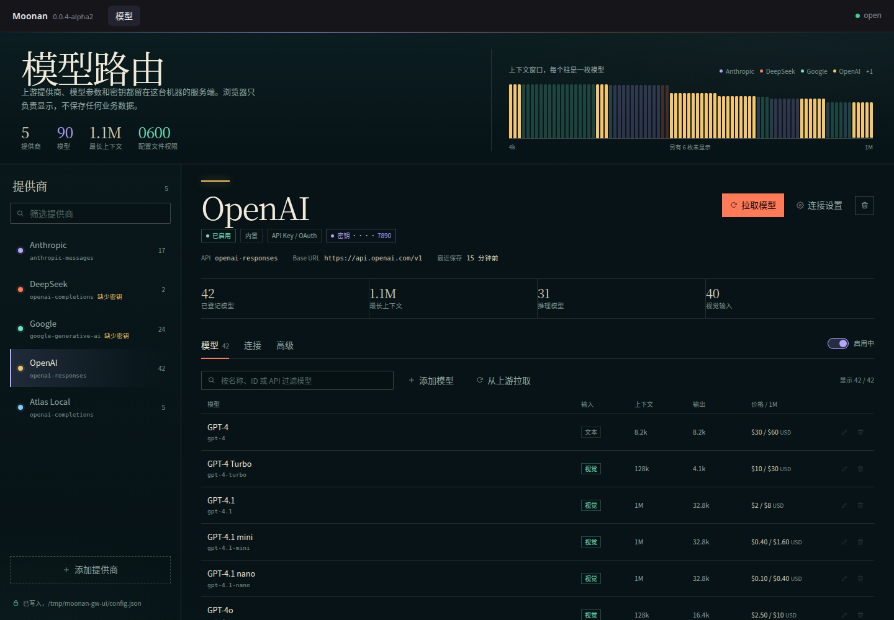
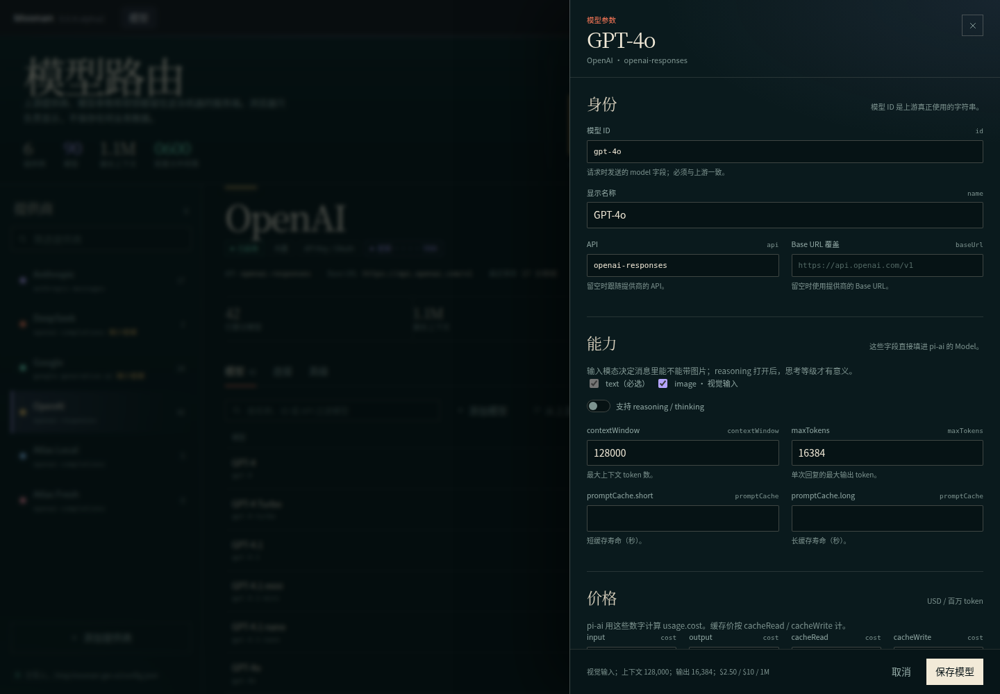
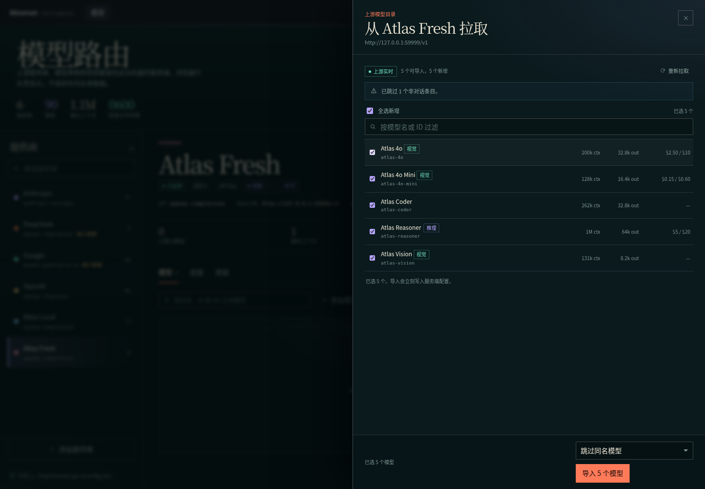
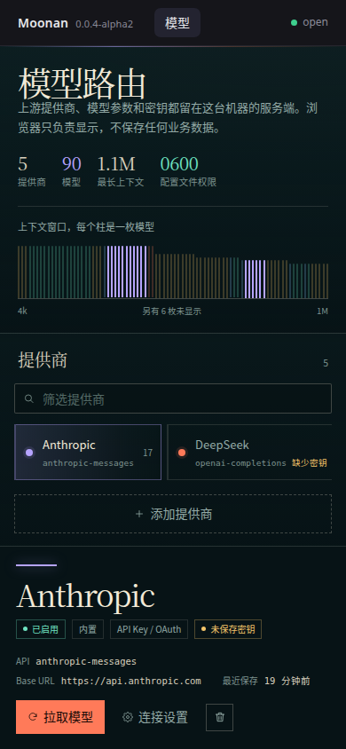

# ai-gateway

Moonan 的内置「模型」插件。它把 pi-ai 的提供商和模型配置搬进一个本地面板，并把所有业务数据
写在服务端——浏览器只拿快照，不写任何浏览器存储。

```bash
# 装好平台再加载这个插件（两者要在同一棵树里）
npm i -g @moonan_ai/moonan @moonan_ai/ai-gateway
moonan --plugin @moonan_ai/ai-gateway

# 或者从仓库根目录
pnpm install
pnpm dev          # 只加载模型面板
pnpm start        # 同上去掉 chord 的写入校验
```

打开 <http://127.0.0.1:21315/#/ai-gateway>，通过「添加提供商」接入第一路上游。

## 界面







小屏时提供商变成横向频道条，表单与抽屉占满宽度。



## 数据放在哪

配置是平台统一数据文件里的 `ai-gateway/config` 数据集，默认文件
`~/.moonan/data.json`：

- 平台目录 `0700`，文件 `0600`；写入采用临时文件 + fsync + rename 的原子替换；
- 每次保存前把上一版复制到 `data.json.bak`；
- 主文件损坏时先尝试 `.bak`；两者都不可用时保留 `data.json.corrupt-<timestamp>.json`；
- API Key 以明文保存在统一数据文件里（面板不假装它是密钥链），快照和 HTTP 响应只含 `hasKey` 与末四位提示；
- `/api/data/export` 默认脱敏，`?includeSecrets=1` 才导出明文；导入脱敏包时按 provider id 保留已有密钥。

路径可用 `--data-file` 或环境变量覆盖：

```bash
node packages/platform/bin/moonan.js --plugin @moonan_ai/ai-gateway --data-file /path/to/data.json
MOONAN_DATA_FILE=/path/to/data.json node packages/platform/bin/moonan.js --plugin @moonan_ai/ai-gateway
```

旧的 `~/.moonan/ai-gateway/config.json` 不再读取；如需保留配置，请先手动备份并重新录入。这是 v0.0.x alpha 的破坏性变更。

## 配置了什么

**提供商**：pi-ai 的内置目录（42 个提供商，添加时导入对话模型），或自定义端点。
字段：ID、显示名、API、Base URL、API Key、Provider 请求头、Provider 环境变量、启用状态。

**模型**：pi-ai `Model` 的对话字段全部可以编辑。

| pi-ai 字段 | 面板位置 |
|---|---|
| `id` / `name` / `api` / `baseUrl` | 身份 |
| `input` / `reasoning` | 能力 |
| `contextWindow` / `maxTokens` / `promptCache` | 能力与上下文 |
| `cost`（含 `tiers`） | 价格 |
| `thinkingLevelMap` | 推理等级映射 |
| `inputLimits`（含图片 resize） | 输入限制 |
| `samplingParams` / `samplingParamsByThinkingLevel` | 采样参数（JSON） |
| `compat` | 兼容性；表单从 pi-ai 的 `CompatSchemasByApi` 生成，字段不会漂移 |
| `headers` | 模型请求头 |

**全局请求默认值**：`temperature`、`maxTokens`、`transport`、`cacheRetention`、`timeoutMs`、
`maxRetries`、`maxRetryDelayMs`、`websocketConnectTimeoutMs`、`toolChoice`、`reasoning`、
`thinkingBudgets`、`deferred`、`metadata`、`samplingParams`、发现超时。

## 从上游拉模型

发现请求使用服务端保存的密钥，浏览器不接触明文。端点按 API 选择：

- OpenAI 兼容：`GET {baseUrl}/models`
- Anthropic：`GET {baseUrl}/v1/models`
- Google Generative AI：`GET {baseUrl}/models`
- Azure：`GET {baseUrl}/models?api-version=…`
- Bedrock / Vertex：直接返回 pi-ai 内置目录（这些 API 不提供通用枚举）
- 本机 OpenAI 兼容端点失败时回退到 Ollama `GET {origin}/api/tags`

返回值会归一化上下文窗口、输出上限、模态、价格和 reasoning 标记，跳过 embedding / 音频 /
图像生成这类非对话条目。导入时可以选择跳过或覆盖同名模型。

## 给其他插件用

服务端切面把配置好的模型注册进 `ModelProviders`（id `ai-gateway`）。其他服务端插件按 id 查找，
不需要依赖 ai-gateway 的内部模块：

```js
import { ModelProviders } from "@moonan_ai/sdk";
import { AI_GATEWAY_PROVIDER_ID, isAiGatewayModelProvider } from "@moonan_ai/ai-gateway/model-provider";

const providers = api.registry(ModelProviders);
const provider = providers.get(AI_GATEWAY_PROVIDER_ID, ctx);
if (isAiGatewayModelProvider(provider)) {
	const runtime = provider.runtime(); // { models: MutableModels, warnings, revision }
	const model = runtime.models.getModel("atlas", "hand-written");
}
```

`runtime()` 含凭据，只能服务端使用；不要放进浏览器切面或远程 Chord 对象。

## 服务端接口

面板通过 Chord 对象读写；同一个服务也暴露只读/探测接口，方便脚本验收：

```bash
curl http://127.0.0.1:21315/api/ai-gateway/status
curl http://127.0.0.1:21315/api/ai-gateway/config
curl http://127.0.0.1:21315/api/ai-gateway/presets
curl 'http://127.0.0.1:21315/api/ai-gateway/models?provider=anthropic'
curl -X POST http://127.0.0.1:21315/api/ai-gateway/discover -H 'content-type: application/json' -d '{"providerId":"anthropic"}'
curl -X POST http://127.0.0.1:21315/api/ai-gateway/reload
```

`/api/ai-gateway/config` 和 `/api/ai-gateway/models` 不返回 API Key。

## 开发

```bash
pnpm --filter @moonan_ai/ai-gateway typecheck
pnpm --filter @moonan_ai/ai-gateway build
pnpm --filter @moonan_ai/ai-gateway test
```

浏览器切面是单个 ESM（`dist/web.js`），只从 shell 的 import map 取 React、Chord、TypeBox 和 SDK。
服务端切面是 `dist/server.js`，通过包 `exports` 的 `.` 与 `./web` 被平台解析；`./model-provider` 给消费者提供类型辅助。
